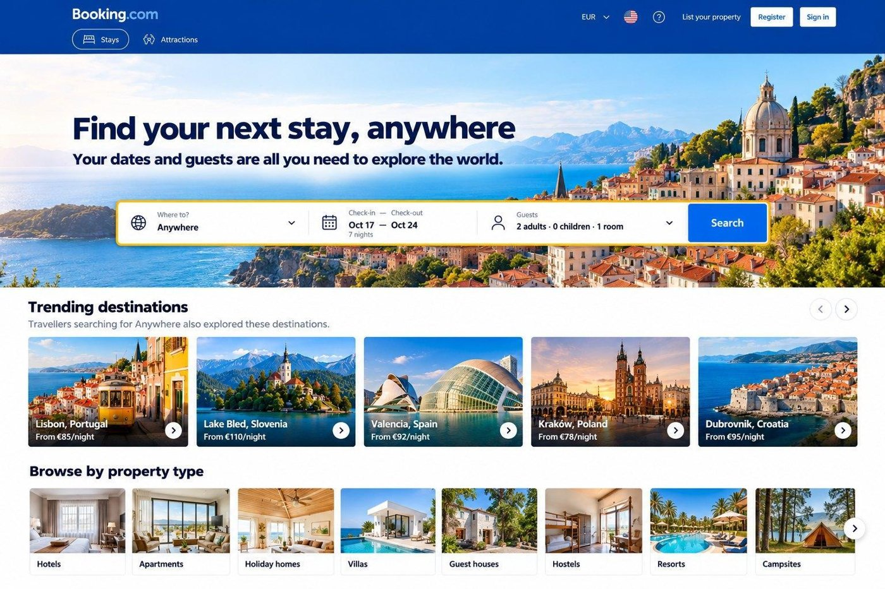
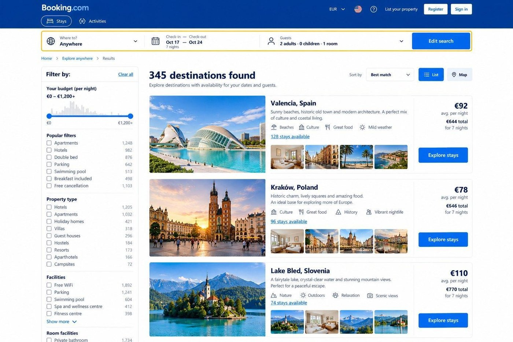
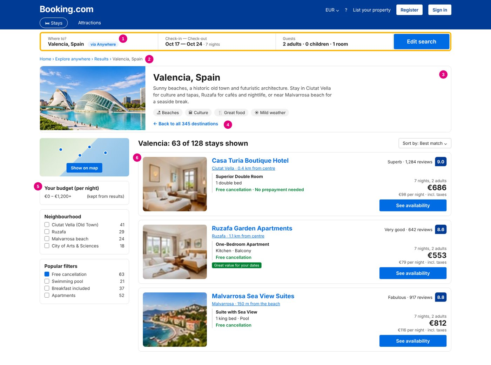

# 01 · Booking.com "Anywhere": date-led destination discovery

**Product Management Academy · Homework 1 · Feature proposal**

> Let travellers start with **when** and **who**, and help them discover **where**, so Booking.com captures people who know their dates but have not chosen a destination.

| | |
|---|---|
| **Task** | Pick an app, propose a new feature: problem statement, MVP scope (≤10 must-haves, 3–5 cuts), North Star + supporting metrics, and a budget-cut scenario |
| **Full document** | [proposal.md](proposal.md) · [PDF](feature-proposal.pdf) |
| **Continued in** | [02 · Design, prototype & FRD](../02-design-prototype-booking-anywhere/) |

---

## Problem statement

Travellers who know **when** they want to travel but are flexible about **where** are underserved by Booking.com's destination-first search: they must pick a destination before they can explore options. As a result, some potential customers abandon their search, or never discover destinations that fit their dates, group size and budget.

Helping these travellers move from uncertainty to a bookable destination could unlock **incremental bookings** and lay the foundation for Booking.com's longer-term ambition to become a place-discovery platform.

**Why now:** 59% of travellers had no specific destination in mind, or were weighing several, when they started planning *(Expedia Group & Luth Research, The Path to Purchase, 2023)*.

## The solution in 3 screens

| 1. Home: choose "Anywhere" | 2. Destinations that fit | 3. Explore stays |
|---|---|---|
|  |  |  |

## MVP scope

**Principle:** validate whether date-led discovery generates *incremental* bookings before building a broader inspiration platform.

**Must-haves (9)**
1. "Anywhere" search option
2. Travel date selection
3. Number of travellers and rooms
4. Real available accommodation across destinations
5. Price visibility (per night + total)
6. Basic destination information
7. Essential filters (budget, property type, a few facilities)
8. Direct hand-off to the existing booking flow
9. Experimentation and analytics

**Explicit cuts**
- Saved collections and folders
- Personalised recommendations
- Transport and total trip cost (accommodation only)

## Success metrics

| Level | Metric |
|---|---|
| **North Star** | **Incremental completed bookings**: completed (not cancelled) bookings per eligible search session, test minus control |
| Supporting | Search-to-booking conversion of Anywhere sessions |
| Supporting | Destination discovery engagement (% sessions opening "Explore stays" or a property) |
| Adoption / retention | Adoption rate, WAU/MAU, sessions per planning cycle, 7-day return rate |

## Budget cut: board halves the budget, Series A date stays

- **Cut:** flexible dates. Fixed check-in/check-out only.
- **Simplify:** rule-based ranking (availability, price, popularity) instead of a recommendation engine.
- **Protect:** the Anywhere entry point, date and traveller inputs, real availability, the existing booking flow and reliable experiment tracking.

> *"We can cut the breadth of the experience, but not our ability to learn."*

## Key decisions & trade-offs

- **Incremental bookings, not clicks, as North Star.** Browsing-heavy users (the "visual wanderer" persona) could inflate engagement without creating value, so success is measured against a control group.
- **Reuse the existing booking flow.** The MVP adds one entry point and one new results type. Everything after that is existing product, which keeps cost low and the experiment clean.
- **Only show destinations with real availability.** An inspiration list with nothing bookable would break trust with the family persona.

## What I'd do differently / next

- Validate the 6% adoption assumption with a fake-door test before building.
- Run real user interviews (the four in this exercise are illustrative).
