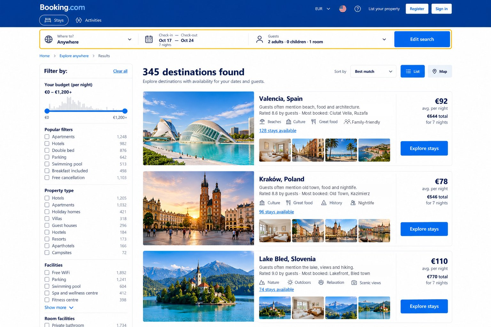

# Clickable prototype: "Anywhere"

**▶ [Open the clickable prototype](https://yufokina.github.io/product-manager-porfolio/02-design-prototype-booking-anywhere/2-prototype/)**

**Built with:** Claude (Anthropic), as a single self-contained HTML file ([index.html](index.html)).

## Flows

| # | Flow | Steps |
|---|---|---|
| 1 | **Search without a destination** | Home → focus "Where to?" → choose "Anywhere" → add dates & guests → Search |
| 2 | **Compare destinations** | Destination results → filter by budget / property type / popular filters → sort → open a destination |
| 3 | **Explore stays and hand off to booking** | Destination page ("via Anywhere" tag, data-based summary) → standard filters (budget, property type, review score …) → "See availability" → existing property page |

**Try this:** set guests to 2 adults + 2 children. Only destinations and stays that fit four people remain (the family persona). Tick **Show annotations** to see why each element on Screen 3 exists.

## Screenshots

| Screen 1 · Home | Screen 2 · Destination results | Screen 3 · Explore stays |
|---|---|---|
|  |  |  |

Numbers 1–6 on Screen 3 match the requirements in the [FRD](../3-requirements/frd.md#7-functional-requirements-screen-3-explore-stays).

> Concept prototype for a learning exercise, not affiliated with Booking.com. Hotel names, prices and counts are invented.

## Prompt I used

```
[paste the main prompt you gave the AI tool]
```
